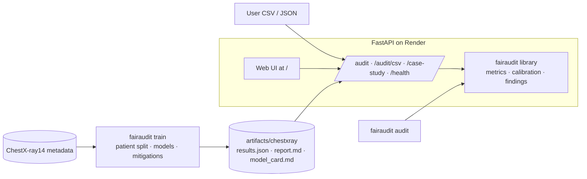

# fairaudit: fairness audits for binary classifiers

[](https://github.com/zeineeb33/fairness-in-Artificial-Intelligence/actions/workflows/ci.yml)

**Live demo:** https://fairaudit-uwq7.onrender.com (free Render instance: the first request after a period of inactivity can take up to a minute while it wakes up) · [API docs](https://fairaudit-uwq7.onrender.com/docs)

`fairaudit` is a Python library, CLI and web service that audits a binary classifier for
group fairness: per-group error rates, disparity metrics (disparate impact with the 80% rule,
demographic parity, equal opportunity, equalized odds), calibration by group, and findings in
plain English. It ships with a reproducible case study on NIH ChestX-ray14 metadata that trains
baseline models, applies four mitigation strategies and compares accuracy with fairness. It
deploys as a single Docker web service on Render's free tier.

> **Disclaimer:** the case-study models see only image *metadata* (age, sex, view position,
> image size, follow-up number), never the X-ray. They are a fairness case study, not a clinical tool.

## Architecture



## Features

- **Metrics library** (numpy only): selection and base rates, TPR/FPR/FNR/PPV per group, disparate
  impact ratio, demographic parity, equal opportunity, equalized odds and predictive parity
  differences, ROC AUC, ECE/Brier calibration by group. Unit-tested on hand-computed examples
  and cross-checked against `fairlearn` and scikit-learn.
- **Mitigations:** Kamiran–Calders reweighing, sensitive-attribute removal, PCA representation,
  and per-group thresholds (demographic parity or equal opportunity).
- **Pipeline:** `fairaudit train` reproduces the original notebook study on held-out patients and
  writes JSON results, a Markdown report and a model card.
- **CLI gate:** `fairaudit audit preds.csv ... --fail-on-findings` exits with code 1 when a policy
  is breached, so it can gate a CI pipeline.
- **API + UI:** typed FastAPI endpoints with OpenAPI docs at `/docs`, and an upload-and-map-columns
  web page with charts.

## Project structure

```
src/fairaudit/
  metrics.py, calibration.py   group metrics (numpy)
  audit.py, report.py          audit() / audit_dataframe() -> typed AuditReport
  mitigation.py                reweighing, group-threshold optimizer
  casestudy/                   ChestX-ray14 data prep, study runner, results schema
  render.py, templates/        Markdown report and model card (Jinja2)
  api/                         FastAPI app + static UI
  cli.py                       typer CLI: train, audit, serve
configs/chestxray.yaml         study configuration
data/                          ChestX-ray14 metadata (see Data)
notebooks/                     original university notebook (French, unchanged)
tests/                         pytest suite (68 tests, 98% coverage)
```

## Quickstart

```bash
uv sync                                    # Python 3.12, all extras + dev tools
uv run fairaudit train                     # case study -> artifacts/chestxray/
uv run fairaudit serve                     # http://localhost:8000 (UI) and /docs
uv run pytest --cov                        # tests
```

With Docker (the case study is trained during the build):

```bash
docker build -t fairaudit .
docker run -p 8000:8000 fairaudit
```

## API examples

```bash
curl localhost:8000/health
# {"status":"ok","version":"0.1.0","case_study_available":true}

curl -X POST localhost:8000/audit/csv -F file=@preds.csv \
  -F label=label -F prediction=pred -F score=score -F sensitive=gender -F sensitive=age_group

curl -X POST localhost:8000/audit -H 'content-type: application/json' -d '{
  "records": [{"label": 1, "score": 0.81, "sex": "F"}, {"label": 0, "score": 0.35, "sex": "M"}],
  "mapping": {"label": "label", "score": "score", "sensitive": ["sex"]}}'

curl localhost:8000/case-study            # full case-study results (JSON)
```

## Results (ChestX-ray14 metadata case study)

Produced by `uv run fairaudit train --config configs/chestxray.yaml` (seed 42), and reproduced
identically by the Docker build. Data: 54,840 images of 14,998 patients after removing 8 rows with
implausible ages. Split by patient into train/validation/test; metrics are measured on the
9,993 test images. Mitigations target age 50–70 vs. the other ages, the attribute studied in the notebook.

| Model | Accuracy | ROC AUC | DI ratio (age 50–70) | EOdds diff. (age 50–70) | DI ratio (view position) |
|---|---:|---:|---:|---:|---:|
| Decision tree, depth 3 (notebook) | 0.606 | 0.631 | 0.48 | 0.233 | 0.48 |
| Logistic regression (baseline) | 0.591 | 0.617 | 0.47 | 0.185 | 0.11 |
| Reweighing (Kamiran–Calders) | 0.600 | 0.614 | **0.99** | 0.016 | 0.15 |
| Sensitive attribute removed | 0.601 | 0.606 | 0.89 | 0.033 | 0.09 |
| PCA representation (5 comp.) | 0.596 | 0.614 | 0.47 | 0.186 | 0.12 |
| Group thresholds (demographic parity) | 0.600 | 0.617 | 0.95 | 0.037 | 0.16 |
| Group thresholds (equal opportunity) | 0.600 | 0.617 | 0.97 | **0.006** | 0.16 |

DI = disparate impact ratio (min/max selection rate, ≥ 0.8 passes the four-fifths rule);
EOdds = equalized-odds difference. Accuracy differences below 0.01 are within sampling noise.

Takeaways:

- The baseline **amplifies** the age disparity. In the labels, the 50–70 group's positive rate
  is only 7.2 points higher (DI 0.89 on the full dataset). The model predicts positive for 36.3%
  of 50–70 vs 17.1% of other ages (DI 0.47).
- Reweighing, attribute removal and group thresholds all pass the four-fifths rule at no
  measurable accuracy cost. **PCA does not**: it leaves the disparity unchanged.
- Fixing one attribute does not fix another. The view position (AP, mostly bedside scans, vs PA)
  is the strongest shortcut, with DI 0.09–0.16 for every logistic-regression variant.

Full report and model card: `artifacts/chestxray/report.md`, `model_card.md` after a run, or
`/case-study/report` and `/case-study/model-card` on the service.

## Engineering decisions and trade-offs

- **Patient-level split.** Patients have up to 173 images, so a row-level split would let one
  patient appear in both train and test.
- **Metrics on predictions, not labels.** The original notebook computed post-mitigation fairness
  on the ground truth, which made every mitigation look identical. That conclusion (that PCA
  helped) does not hold once fairness is measured on the model's predictions.
- **Own metrics, fairlearn as oracle.** The core library depends only on numpy, pandas and pydantic.
  `fairlearn` is a test dependency used to cross-check every disparity metric.
- **Small runtime image.** scikit-learn is needed only to train, so training runs in a Docker build
  stage. The runtime image (291 MB) holds the API dependencies and the generated artifacts. It uses
  about 82 MiB of RAM after auditing a 10k-row CSV, which fits Render's 512 MB free tier.
- **Deterministic group thresholds** (no randomization like fairlearn's `ThresholdOptimizer`): easier
  to explain, but rates are equalized only approximately.
- **Limits:** uploads are capped (10 MB, 200k rows) and CPU-bound work runs off the event loop.

## Deploy on Render

1. Render dashboard → **New** → **Blueprint** → select this repository.
2. Render reads `render.yaml`: a free Docker web service with health check `/health` and auto-deploy
   on push. The image trains the case study during the build, so no extra setup is needed.

The free tier sleeps when idle, so the first request after a pause takes a few seconds.

## Roadmap

- Bootstrap confidence intervals for every group metric.
- Intersectional groups (e.g. sex × age).
- Randomized threshold post-processing and in-processing constraints.
- An image model, so the case study covers the X-rays rather than only their metadata.

## Background

This project started as a university fairness project at Université Paris-Saclay. The original
French notebook (descriptive analysis, decision tree, base rates, TPR/FPR, calibration, reweighing,
attribute removal, PCA) is kept unchanged in `notebooks/`; it expects the CSV in its working
directory (`data/JEMLI_ZEINEB.csv`).

## Data and license

`data/` holds a subset of the [NIH ChestX-ray14](https://nihcc.app.box.com/v/ChestXray-NIHCC)
metadata (`JEMLI_ZEINEB.csv`, the 54,848-row file used by the pipeline, and `metadata.csv`, a
5,610-row sample from the original project that the pipeline does not use). The data is provided by the
NIH Clinical Center. Cite Wang et al., *ChestX-ray8*, CVPR 2017, and acknowledge the NIH Clinical
Center. Code is MIT-licensed (see `LICENSE`).
